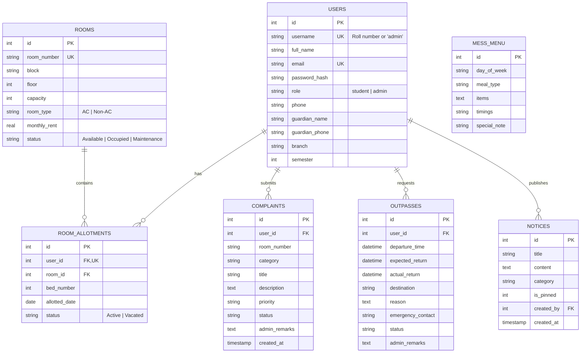

# 🏢 HostelSphere - Hostel Management Website

> **Capstone Project Synopsis Implementation**  
> **Student:** Jiyansh Sardana (Roll No: **25001003043**)  
> **Degree:** Bachelor of Technology in Computer Engineering (3rd Semester, July–Dec 2026)  
> **Supervisor:** Ms. Pratima Sharma  
> **Institution:** Department of Computer Engineering, Faculty of Informatics & Computing, J.C. Bose University of Science & Technology, YMCA, Faridabad - 121006  

---

## 📖 Project Overview

Hostels traditionally rely on scattered, inefficient channels such as physical notice boards, unofficial WhatsApp groups, and verbal communication for essential day-to-day operations. This leads to outdated information, missed announcements, lack of accountability for maintenance issues, and paper-heavy leave/outpass processes.

**HostelSphere** is a full-stack, role-based web application that centralizes all hostel workflows into a single transparent platform:
- **Generic Architecture**: Built to be adaptable to any university, college, or private hostel.
- **Role-Based Access Control (RBAC)**: Distinct permissions and interactive portals for **Students (Residents)** and **Administrators (Chief Warden & Staff)**.
- **Dynamic Real-Time Information**: Real-time announcements, daily & weekly mess dining schedules, interactive room occupancy mapping, ticketed maintenance complaints, and digital gate outpasses.

---

## 🛠️ Technology Stack

| Layer | Technology | Details |
|---|---|---|
| **Frontend** | HTML5, CSS3, JavaScript | Responsive modern design system with CSS custom properties, cards, badges, mobile navbar, printable media styles |
| **Backend** | Python 3.14+, Flask 3.1 | Modular route handlers, session management, security filters, custom Jinja context processors |
| **Templating** | Jinja2 | Dynamic server-side rendering, inheritance layouts, date/time formatting filters |
| **Database** | SQL / SQLite3 | Relational schema with foreign keys, cascading constraints, and indexing (readily extensible to PostgreSQL / MySQL) |
| **Authentication** | Session-Based RBAC | Werkzeug cryptographic password hashing, role-protected decorators |

---

## ✨ Key Modules & Capabilities

### 🎓 1. Student Portal
- **Personal Dashboard**: Instant summary of allotted room, bed number, roommates, today's 4-meal mess preview, active complaints, and leave pass statuses.
- **Accommodation & Roommates Directory**: Full details of allocated room (block, floor, room type, monthly rent) with contact records of verified room partners.
- **Maintenance & Complaints Desk**:
  - Submit tickets categorized under *Plumbing, Electrical, Wi-Fi, Furniture, Cleanliness, Other*.
  - Set priority (*Low, Medium, High, Urgent*).
  - Track live ticket progress (*Pending &rarr; In Progress &rarr; Resolved* with admin remarks).
- **Digital Leave & Outpass Workflow**:
  - Request gate leave with departure, expected return, destination, emergency contact, and reason.
  - Automatically generate a **Printable Official Security Gate Pass** complete with approval verification stamps.
- **Notice Board**: Read pinned circulars and filter by category (*Urgent, General, Mess, Event, Maintenance, Rules*).
- **Mess Menu**: 7-day schedule (Monday to Sunday) for Breakfast, Lunch, Evening Snacks, and Dinner with meal timings and dietary notes.
- **Profile Settings**: Update phone number, emergency guardian details, or change password.

### 🛡️ 2. Administrator (Warden & Staff) Portal
- **Executive Operations Dashboard**:
  - Live metric widgets: Total Registered Residents, Rooms Managed, Bed Occupancy %, Pending Maintenance Tickets, Pending Outpasses.
  - Urgent maintenance workbench and pending outpass approval queue.
- **Room Inventory & Allotment Manager**:
  - Add new rooms with block, floor, bed capacity, room type (AC/Non-AC), and monthly rent.
  - Allocate unallotted students to available beds in any room.
  - Deallocate students and automatically free beds.
  - View real-time occupant lists grouped by room.
- **Maintenance Complaint Dispatch**:
  - Filter tickets by status (*Pending, In Progress, Resolved, Rejected*) and category.
  - Update progress, assign technician names, and append resolution notes.
- **Outpass Review & Gate Control**:
  - Approve or reject leave applications with warden verification notes.
  - Mark student return timestamps when residents re-enter campus.
- **Announcement Publisher**:
  - Create, pin to top, edit, or delete circulars with categories and timestamps.
- **Mess Schedule Editor**:
  - Update dishes, meal timings, and special chef notes for any day and meal type.
- **Student Roster**:
  - Searchable resident registry with roll numbers, contact numbers, and guardian details.

---

## 🚀 Quick Start Guide

### Option A: Using the Automated Runner (Recommended)
```bash
./run.sh
```
This automatically verifies the virtual environment, seeds realistic demonstration data, and launches the server at `http://127.0.0.1:5001`.

### Option B: Manual Setup
1. **Activate Virtual Environment**:
   ```bash
   source venv/bin/activate
   ```
2. **Install Dependencies**:
   ```bash
   pip install -r requirements.txt
   ```
3. **Seed Database with Sample Data**:
   ```bash
   python seed_data.py
   ```
4. **Launch Application**:
   ```bash
   python app.py
   ```
5. Open your web browser at: **`http://127.0.0.1:5001`**

---

## 🔑 Demonstration Accounts

The database comes pre-populated with realistic campus records for immediate evaluation:

| Role | Username / Roll Number | Password | Notes |
|---|---|---|---|
| **Chief Warden (Admin)** | `admin` | `admin123` | Full administrative control & approval access |
| **Student (Resident)** | `25001003043` | `student123` | Jiyansh Sardana (Computer Engg, Room A-101) |
| **Student (Resident)** | `25001003044` | `student123` | Rahul Sharma (Room A-101 roommate) |
| **Student (Resident)** | `25001003045` | `student123` | Aarav Mehta (IT Dept, Room A-102) |
| **Student (Resident)** | `25001003046` | `student123` | Priya Verma (ECE Dept, Room B-101) |

*(Note: The login page also includes 1-click Demo Quick Fill buttons for rapid testing!)*

---

## 🧪 Automated Test Suite

A complete test suite covering authentication, RBAC boundaries, student complaint/outpass submissions, notice CRUD, mess menu updates, and room allotments is included.

Run tests:
```bash
./venv/bin/python test_app.py
```
Expected output:
```text
Ran 11 tests in 1.2s
OK
```

---

## 🗄️ Relational Database Schema



---

## 🔮 Future Scope (As Outlined in Chapter 3)
- **Mobile Application**: Native mobile app wrapper for instant on-the-go access.
- **Push & SMS Notifications**: Urgent SMS / WhatsApp API integration for emergency announcements.
- **Biometric & QR Gate Integration**: Direct turnstile API synchronization for automatic check-in/check-out.
- **Fee Payment Gateway**: Online hostel dues and mess rebate tracking.
- **Multi-Tenant Campus Scaling**: Multi-hostel block hierarchy with floor-wise warden assignments.
